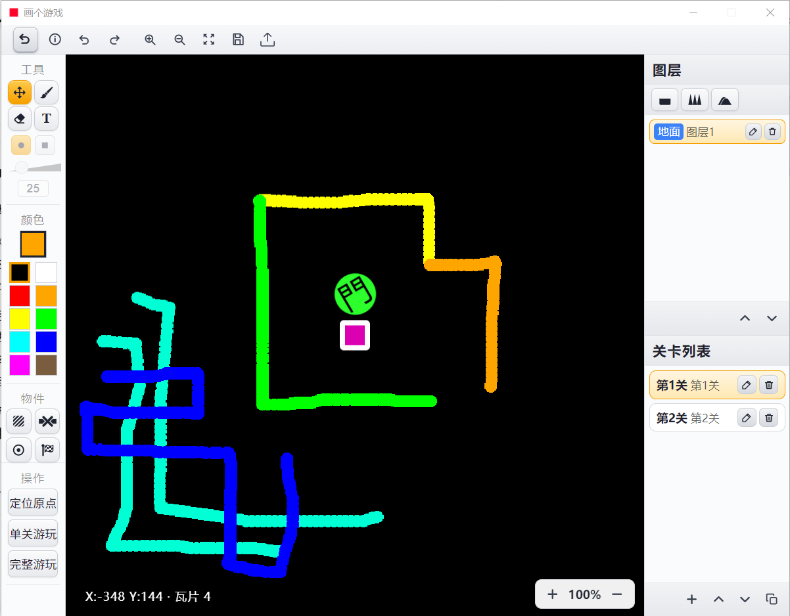
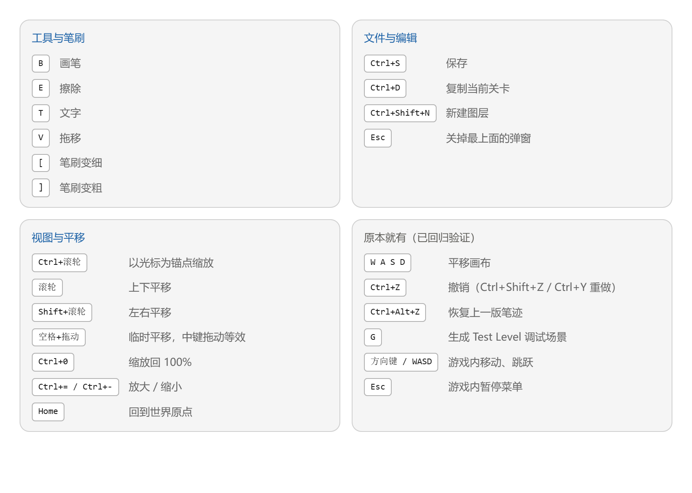

# 画个游戏 · Huageyouxi

> **你画什么，它就能玩什么。** —— 一个画笔驱动的横版闯关游戏编辑器 + 运行时。

[](https://github.com/DSDlonDTX/huageyouxi#-关于-vibe-coding)
[](https://www.electronjs.org/)
[](https://github.com/DSDlonDTX/huageyouxi/releases)
[](LICENSE)

---

## ⚡ 关于 Vibe Coding

> [!IMPORTANT]
> **本项目 100% 由 Vibe Coding 完成。**
>
> 全部代码 —— 从瓦片渲染引擎、笔迹数据结构、到打包链路 —— 都是在与 AI 的自然语言对话中
> 一句一句「聊」出来的。人类负责**提需求、做取舍、验收结果**；AI 负责**写实现、跑自检、
> 改 bug**。没有手写一行架构设计文档，也没有提前画过类图。

这条路线不是"AI 帮我补全代码"，而是**对话即开发**：提出一个现象、定位一处根因、
推开一版实现，循环往复。

为了让这种开发方式不至于失控，项目里长出了一套**自建自检 / 回归套件**：

| 套件 | 断言数 | 覆盖内容 |
|---|---|---|
| UI_TEST | 66 | 界面结构、控件状态、CSS 取值 |
| TILE_TEST | 61 | 瓦片渲染、坐标换算、脏区回收 |
| TEXT_TEST | 21 | 文字工具、字形度量、字体栈 |
| EXPORT_TEST | 29 | `.hgyx` 导出打包完整性 |
| IMPORT_TEST | 58 | `.hgyx` 导入解包与兼容旧版 |
| UNDO_TEST | 83 | 撤销栈、图层与关卡切换 |
| CLOSE_TEST | 29 | 退出保存、进程清理 |
| **合计** | **347** | 每次改动后全量跑一遍，必须 **347/0** 才收工 |

这套东西本身就是 Vibe Coding 的产物：人类只说了"你得保证改不坏"，实现方式由 AI 决定。

---

## 这是什么

一个**横版闯关游戏**，但关卡不是设计出来的 —— 是**画出来的**。

打开编辑器，你可以：

- 在**无限画布**上用画笔、橡皮、直线、矩形、圆、文字自由绘制
- 把画出来的东西**直接变成地形**（像素级碰撞，画什么就是什么）
- 放置**起点**和**终点**，按下测试键立刻就能玩
- 分**多个图层**，分别控制地面、装饰、前景
- 把做好的关卡**导出成 `.hgyx` 文件**发给别人，别人导入就能玩
- 给关卡配**自定义背景音乐**

### 界面预览





---

## 下载

### 方式一：下载打包好的应用（推荐，无需配置环境）

前往 **[Releases 页面](https://github.com/DSDlonDTX/huageyouxi/releases)** 下载最新的
`画个游戏v1.0.7z`，解压到**任意目录**（路径可以带中文和空格），双击 `HuageyouxiGame.exe` 即可运行。

> 首次启动会自动导入随包内置的 35 关示例关卡，打开就能直接玩。

### 方式二：从源码运行

需要 [Node.js](https://nodejs.org/) 18 或更高版本。

```bash
git clone https://github.com/DSDlonDTX/huageyouxi.git
cd huageyouxi
npm install
npm start
```

---

## 快速开始

1. 启动后进入**关卡列表**，双击任意关卡卡片进入编辑器
2. 用 **`B`** 画笔在画布上涂几笔 —— 这就是你未来的地面
3. 用 **`V`** 拖移工具把画布挪到合适位置，**`Ctrl+滚轮`** 缩放
4. 在左侧工具箱切换到 **起点 / 终点**，各放一个
5. 按 **`Esc`** 关掉弹窗，点顶部的**▶ 测试**按钮 —— 用 `WASD` 或方向键操控，`空格` 跳
6. 满意后 **`Ctrl+S`** 保存，回列表点**导出**得到 `.hgyx`

---

## 快捷键

| 分类 | 快捷键 | 功能 |
|---|---|---|
| **工具** | `B` / `E` / `T` / `V` | 画笔 / 擦除 / 文字 / 拖移 |
| | `[` / `]` | 笔刷变细 / 变粗 |
| **文件** | `Ctrl+S` | 保存 |
| | `Ctrl+D` | 复制当前关卡 |
| | `Ctrl+Shift+N` | 新建图层 |
| | `Esc` | 关掉最上面的弹窗 |
| **视图** | `Ctrl+滚轮` | 以光标为锚点缩放 |
| | `滚轮` / `Shift+滚轮` | 上下平移 / 左右平移 |
| | `空格+拖动` | 临时平移（中键拖动等效） |
| | `Ctrl+0` / `Ctrl+=` / `Ctrl+-` | 缩放回 100% / 放大 / 缩小 |
| | `Home` | 回到世界原点 |
| **编辑** | `Ctrl+Z` | 撤销（`Ctrl+Shift+Z` / `Ctrl+Y` 重做） |
| | `Ctrl+Alt+Z` | 恢复上一版笔迹 |
| **游戏内** | `WASD` / 方向键 | 移动、跳跃 |
| | `Esc` | 暂停菜单 |

---

## 技术实现

| 层 | 选型 | 说明 |
|---|---|---|
| 壳 | **Electron 33** | 无边框固定 4:3 桌面窗口；同时支持浏览器内 4:3 居中预览 |
| 渲染 | **原生 Canvas 2D** | 自研**瓦片引擎**，每张瓦片 2048×2048，按需加载 / 回收 |
| 前端 | **零框架** | 纯原生 JS + 单文件 `index.html`，没有 React / Vue / 构建步骤 |
| 关卡格式 | **`.hgyx`** | 自定义 ZIP 容器，兼容旧版单图层格式 |
| 打包 | **@electron/packager** | `resources/app/` 用**普通目录而非 asar**，源码可直接读 |

几个值得一提的设计：

- **按关卡懒加载**：磁盘瓦片目录按关卡序号命名，只有打开中的关卡常驻内存。
  导入一个 35 关的包时，旧实现会整库重读导致峰值 5.2 GiB 内存崩溃；改为懒加载后
  常驻降到 243 MiB。
- **像素碰撞**：没有物理引擎，地面由图层笔迹的行程编码（RLE）直接判定，画到哪就撞到哪。
- **纯自检驱动**：7 个套件共 347 条断言全部通过环境变量开关注入，可在 CI 中无头运行。

---

## 目录结构

```
huageyouxi/
├── index.html          # 编辑器 + 游戏全部 UI 与渲染逻辑（单文件承载）
├── main.js             # Electron 主进程：窗口、存档 IO、.hgyx 打包/解包、自检入口
├── preload.js          # 主进程 ↔ 渲染进程 IPC 桥
├── hgyx.js             # .hgyx 关卡包格式（ZIP 容器）读写
├── package.json
├── icon.ico            # 应用图标
├── 默认关.hgyx          # 内置示例关卡（35 关 / 167 瓦片）
├── *.svg / *.png       # 图标与界面素材
├── *.mp3 / *.ogg       # 背景音乐
└── gameapp/            # 打包工具链
    ├── _build.mjs          # 打包脚本（staging → packager → 改名 → 清理 → 自检）
    ├── _install_tools.cjs  # 确定性安装打包器
    └── _testrun.mjs        # 打包产物验收
```

> 打包产物（`gameapp/HuageyouxiGame/`，约 275 MB）与 `node_modules/` 未纳入版本控制，
> 请从 **Releases** 页面下载。

---

## 从源码打包

```bash
cd gameapp
node _install_tools.cjs   # 安装 @electron/packager 到 gameapp/_tools/
node _build.mjs           # 产出 gameapp/HuageyouxiGame/
```

---

## 许可证

[MIT](LICENSE) © 2026 DSDlonDTX

---

<div align="center">

**这个仓库也是一次记录** —— 记录一个人和 AI 一起，从"我想要个能画游戏的东西"
一路聊到一个 347 条断言全绿的可运行程序。

</div>
